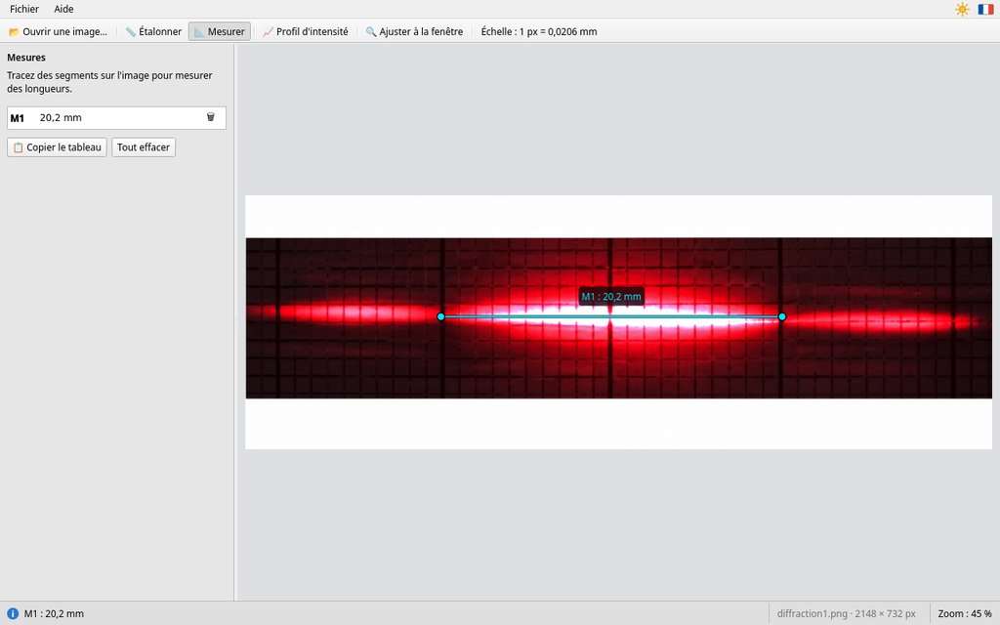
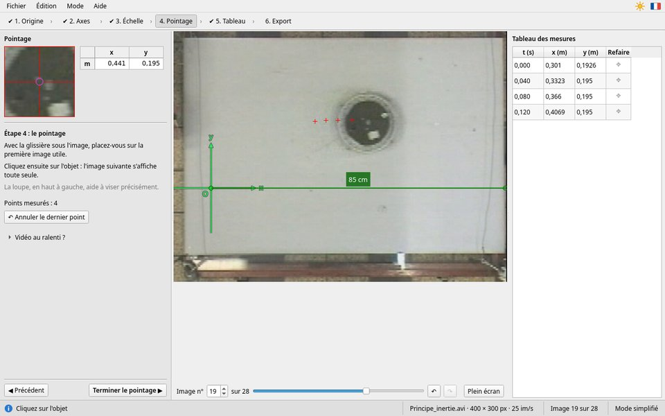
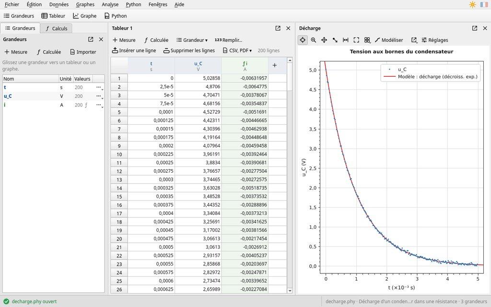
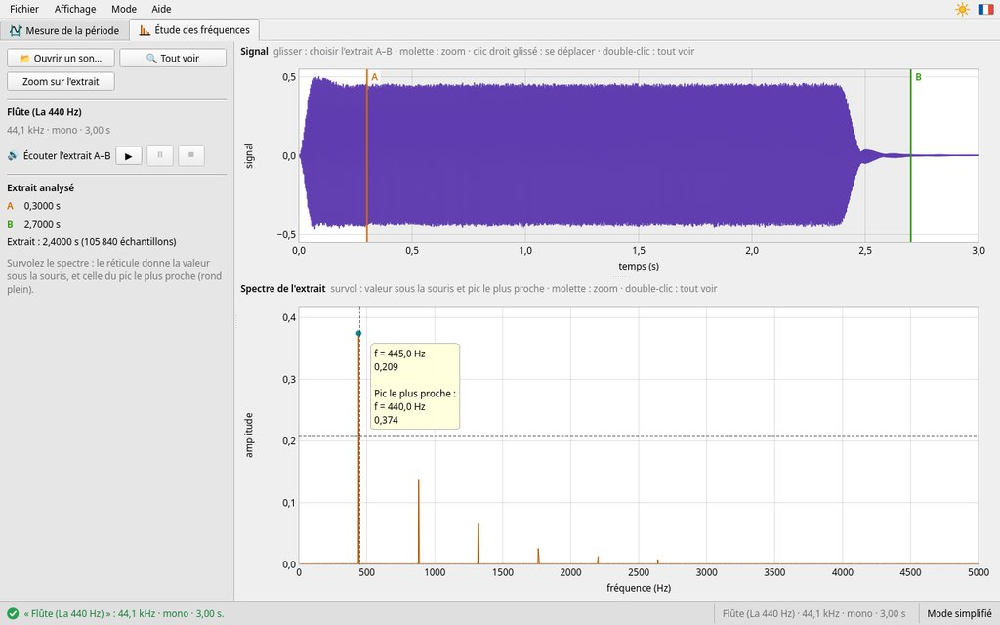

# MevSuite

Quatre logiciels libres pour les TP de physique-chimie au lycée, par Rémi MEVAERE. Ils sont
écrits en C++ avec Qt 6 et fonctionnent sous Linux et Windows. Version actuelle :
0.3.1 ; les changements de chaque version sont notés dans [`CHANGELOG.md`](CHANGELOG.md).

| Logiciel | Rôle | Langues | Licence | Dossier |
|----------|------|---------|---------|---------|
| **MeVPix** | Mesures de longueurs sur une image : étalonnage, mesures, profil d'intensité | français, anglais | MIT | [`mevpix/`](mevpix/) |
| **MeVCine** | Étude cinématique de vidéos : pointage, repère, échelle, export CSV et Python | français, anglais | GPL-3.0-or-later | [`mevcine/`](mevcine/) |
| **MeVReg** | Traitement de données : tableur de grandeurs, graphes, modélisation, incertitudes, Python intégré | français | MIT | [`mevreg/`](mevreg/) |
| **MeVSono** | Analyse spectrale des sons : signal, mesure de période, spectre, fondamentale et harmoniques | français, anglais | MIT | [`mevsono/`](mevsono/) |

Chaque logiciel est un projet CMake indépendant, avec son `README.md` (fonctions, compilation,
tests, organisation du code). « MeV » (mégaélectronvolt) est la signature de l'auteur : les noms
s'écrivent avec le V majuscule (MeVPix…) dans les logiciels et leurs notices, et en minuscules
pour les dossiers, les programmes et les fichiers (`mevpix`…).

Les premières versions, écrites en Rust (interface egui) sous les noms PixMev, CineMev, RegMev et
SpectralMev, ont été remplacées par ces versions C++.

| MeVPix | MeVCine |
|--------|---------|
|  |  |
| **MeVReg** | **MeVSono** |
|  |  |

## Utiliser

- **Notice** : menu **Aide → Notice d'utilisation** (touche `F1`), dans le navigateur. Elle
  s'adresse d'abord aux élèves (prise en main pas à pas), puis aux professeurs (installation sur un
  parc, réglages, idées pour la classe).
- **Réglages** : un seul dossier pour les quatre logiciels, `~/.config/MeVSuite/` sous Linux,
  `%APPDATA%\MeVSuite\` sous Windows, avec un fichier par logiciel (`mevpix.ini`…).
- **Erreurs** : après une erreur imprévue ou un plantage, le logiciel note la cause dans son journal
  (`mevpix.log`, `mevcine.log`, `mevreg.log`, `mevsono.log`, dans ce même dossier) et dit où le
  trouver. Joindre ce fichier à un signalement : suite@sciences-physiques.net.

## Télécharger et installer

Les [Releases](../../releases) du dépôt contiennent, pour chaque logiciel :

| Système | Fichier | Installation |
|---------|---------|--------------|
| Windows x64 | `<Logiciel>-<version>-windows-x64.zip` | version portable : décompresser, lancer `<logiciel>.exe` ; le dossier se copie sur une clé USB |
| Windows x64 | `<Logiciel>-<version>-windows-x64-setup.exe` | installateur : `Program Files\MeVSuite`, menu Démarrer ; parc (WAPT, GPO) : `/VERYSILENT /SUPPRESSMSGBOXES /NORESTART` |
| Linux | `<Logiciel>-<version>-x86_64.AppImage` | sans installation (glibc 2.39 : Ubuntu 24.04, Debian 13, Fedora 40 ou plus récentes) |
| Ubuntu 26.04 | `<logiciel>_<version>_amd64.deb` | `sudo apt install ./<fichier>.deb` |
| Fedora 45 | `<logiciel>-<version>-1.fc45.x86_64.rpm` | `sudo dnf install ./<fichier>.rpm` |

Les versions Windows et les AppImage contiennent tout ce qu'il faut : Qt, Python pour MeVReg, ffmpeg
pour MeVCine (et MeVSono sous Windows). Les paquets `.deb` et `.rpm` utilisent le Qt du système.

## Compiler

Il faut CMake 3.21 ou plus récent, Ninja, un compilateur C++ 20 (C++ 23 pour MeVCine : GCC 14 ou
plus récent) et Qt 6.8 ou plus récent.

| Système | Paquets pour les quatre logiciels |
|---------|-----------------------------------|
| Fedora 45 | `cmake ninja-build gcc-c++ qt6-qtbase-devel qt6-qtsvg-devel qt6-qtmultimedia-devel qt6-qtimageformats python3-devel ffmpeg` (ffmpeg de RPM Fusion) |
| Ubuntu 26.04 | `cmake ninja-build g++ qt6-base-dev qt6-svg-dev qt6-multimedia-dev qt6-image-formats-plugins python3-dev ffmpeg` |
| Windows x64 | [MSYS2](https://www.msys2.org), terminal UCRT64 : `pacman -S --needed mingw-w64-ucrt-x86_64-{toolchain,cmake,ninja,qt6-base,qt6-svg,qt6-multimedia,qt6-imageformats,python,ffmpeg}` |

Dans le dossier d'un logiciel :

```sh
cmake -S . -B build -G Ninja -DCMAKE_BUILD_TYPE=Release
cmake --build build                         # → build/<logiciel>
ctest --test-dir build --output-on-failure  # tests, sans écran
```

ffmpeg sert à MeVCine (lecture des vidéos) et aux tests de MeVSono ; Python (avec ses fichiers
de développement) est intégré à MeVReg. Le `README.md` de chaque logiciel donne ses besoins exacts.

## Versions distribuables

Les scripts de [`packaging/`](packaging/) fabriquent les fichiers des Releases, dans `dist/` :

```sh
packaging/paquet-linux.sh <logiciel> deb    # sur Ubuntu 26.04 (dpkg-dev)
packaging/paquet-linux.sh <logiciel> rpm    # sur Fedora 45 (rpm-build)
packaging/appimage.sh <logiciel>            # sur Ubuntu 24.04 (Qt installé par aqtinstall)
packaging/windows.sh <logiciel>             # dans MSYS2 UCRT64, avec Inno Setup 6
packaging/essai-linux.sh <logiciel> <fichier>   # essai d'un .deb, .rpm ou AppImage sur un système neuf
```

Les paquets `.deb` et `.rpm` sont faits par CPack ([`packaging/paquets.cmake`](packaging/paquets.cmake),
inclus par chaque `CMakeLists.txt` : lanceur, icônes, licence, dépendances).

## Intégration continue

- [`ci.yml`](.github/workflows/ci.yml) compile chaque logiciel et lance ses tests à chaque
  modification, sur **Fedora 45** et **Ubuntu 26.04** (conteneurs, Qt de la distribution) et sur
  **Windows x64** (`windows-2025`, MSYS2 UCRT64 : MinGW-w64, Qt, Python et ffmpeg de MSYS2). Les
  captures d'écran faites par les tests de l'interface sont gardées dans les *artifacts*.
- [`release.yml`](.github/workflows/release.yml) fabrique les versions distribuables, les essaie
  (installation sur un système neuf, démarrage, Python de MeVReg, installation et désinstallation
  silencieuses sous Windows) et, pour une étiquette `v<version>`, les publie dans une Release.

## Licences

- MeVPix, MeVReg et MeVSono : licence MIT ([`LICENSE`](LICENSE)).
- MeVCine : licence GPL version 3 ou ultérieure ([`mevcine/COPYING`](mevcine/COPYING)) ; le
  fichier [`mevcine/NOTICE`](mevcine/NOTICE) décrit les composants libres qu'il intègre.

Chaque logiciel affiche dans **Aide → À propos** les composants libres qu'il utilise, avec leur
licence, et la fenêtre « À propos de Qt ».

## Organisation

```
mevpix/      MeVPix
mevcine/     MeVCine
mevreg/      MeVReg
mevsono/     MeVSono
packaging/   fabrication des versions distribuables (.deb, .rpm, AppImage, Windows)
.github/     workflows d'intégration continue et de publication
```
